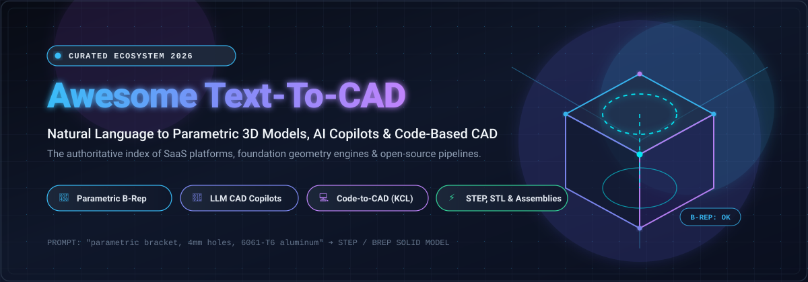

<p align="center">
  
</p>

<p align="center">
  <a href="https://github.com/ishandutta2007/Awesome-Awesome-Awesome"></a>
  <a href="https://discord.gg/jc4xtF58Ve"></a>
  <a href="https://github.com/ishandutta2007/Awesome-Text-To-CAD/stargazers"></a>
  <a href="https://github.com/ishandutta2007/Awesome-Text-To-CAD/network/members"></a>
  <a href="https://github.com/ishandutta2007/Awesome-Text-To-CAD/blob/main/LICENSE"></a>
  <a href="https://github.com/ishandutta2007/Awesome-Text-To-CAD/pulls"></a>
  <a href="https://github.com/ishandutta2007"></a>
</p>

---

# 🚀 Awesome-Text-To-CAD: Generative AI, Parametric 3D & Code-Based CAD Ecosystem

> **The definitive curated directory of SaaS platforms, foundation geometry engines, and open-source repositories powering the revolution from Natural Language Prompts to Production-Grade CAD Models.**

---

## 📑 Table of Contents

- [🔍 Overview & Core Concepts](#-overview--core-concepts)
- [📊 Sector Overview & Market Dynamics](#-sector-overview--market-dynamics)
- [☁️ SaaS & Hosted Platforms](#️-saas--hosted-platforms)
- [💻 Open-Source GitHub Projects](#-open-source-github-projects)
- [🛠️ Architecture & Pipeline Guide for Custom Systems](#️-architecture--pipeline-guide-for-custom-systems)
- [🤝 How to Contribute](#-how-to-contribute)
- [💖 Support & Sponsoring](#-support--sponsoring)
- [📈 Star History](#-star-history)
- [⚖️ Disclaimer](#️-disclaimer)

---

## 🔍 Overview & Core Concepts

**Text-to-CAD** represents the intersection of Large Language Models (LLMs), multi-modal vision-language models, and computational geometry kernels (B-Rep / CSG). Unlike consumer Text-to-3D tools that generate non-parametric polygonal meshes or point clouds, **production-grade Text-to-CAD** produces:

- 📐 **Parametric Feature Trees**: Fully editable sketches, extrusions, fillets, and constraints.
- 🧰 **Boundary Representation (B-Rep)**: Mathematically exact curves and analytical surfaces exported directly as STEP or IGES files for CNC machining, injection molding, and FEA simulation.
- 💻 **Code-as-CAD Scripts**: Human-readable and auditable geometry programs in KCL, Python (CadQuery, build123d), or OpenSCAD.
- 🤖 **Autonomous Agent Tooling**: LLMs executing geometric actions via Model Context Protocol (MCP) servers and headless CAD APIs.

---

## 📊 Sector Overview & Market Dynamics

* **Market Size & Growth Runway**: The global Computer-Aided Design (CAD) software market was estimated at **$11.2 Billion in 2024** and is projected to reach **$19.8 Billion by 2030**, advancing at a compound annual growth rate (CAGR) of ~9.5%. Within this space, the specialized sub-market for **Generative AI in 3D Modeling and Mechanical CAD** is accelerating at a CAGR exceeding **32%**, driven by demands for automated generative engineering, additive manufacturing optimization, and autonomous hardware prototyping.
* **Market Concentration & Competitive Dynamics**: The incumbent CAD sector remains **highly concentrated** around legacy titans (Autodesk, Dassault Systèmes, PTC, and Siemens) with deep proprietary kernel moats (Parasolid, ACIS, ShapeManager). Conversely, the emerging **Text-to-CAD and AI 3D generation frontier is currently moderately fragmented**, split between consumer-facing generative mesh tools and deep-tech B-Rep parametric startups. However, the sector demonstrates marked **winner-take-most dynamics** around foundation geometry code standards (such as Zoo's KCL), browser WASM geometric kernels (OpenCascade.js), and standardized LLM agent interfaces (MCP).

---

## ☁️ SaaS & Hosted Platforms

The following benchmark table tracks leading commercial Text-to-CAD, generative 3D modeling, and AI-assisted CAD platforms. The table is **sorted in descending order by Company Scale** (Valuation, Market Capitalization, or Total Venture Capital Raised).

| 🏢 Platform | 💰 Company Scale (Valuation / ARR / Funding) | 💳 Starting Paid Tier | 🎁 Free Tier / Trial Limit | 🛠️ Core Capabilities & Output Formats |
| :--- | :--- | :--- | :--- | :--- |
| **[Autodesk Fusion 360](https://www.autodesk.com/products/fusion-360/)** | **~$60B Market Cap**<br>*(NASDAQ: ADSK · ~$5.5B ARR)* | **$85 / month**<br>*(or $680 / year)* | **Free for Personal Use** forever (for non-commercial makers earning <$1,000/yr; max 10 active editable documents, basic 2.5-axis CAM); 30-day commercial free trial | Professional parametric 3D CAD/CAM/CAE; automated feature tree generation via Python API and MCP copilot servers; STEP, IGES, SAT, DWG export |
| **[Onshape](https://www.onshape.com/)** | **~$22B Market Cap**<br>*(PTC NASDAQ: PTC · Acquired for $470M)* | **$1,500 / user / year**<br>*(Standard Tier)* | **Free Public Plan** forever for non-commercial hobbyist use (all models public, max 10 private docs, 100 MB private storage); Free education plan | Pure-cloud parametric B-Rep CAD with real-time multi-user collaboration; REST API for automated LLM programmatic modeling; STEP, Parasolid, STL |
| **[Meshy](https://www.meshy.ai/)** | **$1.5B Valuation**<br>*(Unicorn · $400M Series B · >$100M ARR)* | **$20 / month**<br>*(Pro Plan · 1,000 credits/mo)* | **100 free credits / month** forever (~5 text-to-3D generations), 1 concurrent low-priority queue slot, CC BY 4.0 license requirement | State-of-the-art Text-to-3D & Image-to-3D; Smart Quad Topology, automatic UV unwrapping, PBR textures; GLB, FBX, OBJ, STL, USDZ |
| **[Tripo AI](https://www.tripo3d.ai/)** | **~$1.0B Valuation**<br>*(~$445M Series B/B+ funded)* | **$20 / month**<br>*(billed annually at $240/yr)* | **200 free credits / month** forever (~13 models/mo), 1 active task queue, standard resolution, CC BY 4.0 license | Fast generative 3D meshes from natural language prompts and image blueprints; auto-rigging and quad-re-meshing; GLB, FBX, OBJ |
| **[Spline AI](https://spline.design/)** | **~$75M Valuation**<br>*($25M raised · $10M Series A)* | **$12 / month**<br>*(billed annually at $144/yr)* | **Free Forever Plan** ($0/mo) with up to 2 personal files, unlimited viewers, web exports with Spline watermark (AI credits require paid tier) | Browser-based 3D scene creation; interactive 3D physics, real-time collaboration, generative AI 3D styling; GLTF, GLB, WebGL embed |
| **[Zoo Text-to-CAD](https://zoo.dev/)** | **~$30M Valuation**<br>*($5M+ Seed · Venrex & Embedded)* | **$20 / month**<br>*(Plus Tier · 400 reasoning mins)* | **Free Tier** with **20 minutes of Zookeeper AI reasoning time / month** (~$10/mo credit value) and standard exports | First API-native Text-to-CAD engine; outputs human-readable KittyCAD Language (KCL) with conversational iteration; STEP, STL, OBJ, GLTF |
| **[Leo AI](https://www.leo.ai/)** | **~$25M Valuation**<br>*($9.7M total funding · Flint Capital)* | **$15 / user / month**<br>*(Pro Plan)* | **14-day full free trial** upon corporate registration with standard engineering calculation and assembly limits | Mechanical engineering AI copilot; generates complete multi-part CAD assemblies, parts catalog search, B-Rep feature trees; SolidWorks & Onshape sync |
| **[Masterpiece Studio](https://masterpiecestudio.com/)** | **~$15M Valuation**<br>*(~$7M funding · Triptyq Capital & Nvidia)* | **$10.99 / month**<br>*(Starter Plan · ~750 credits)* | **250 free generation credits** upon sign-up to test text-to-3D models without credit card | Conversational generative 3D asset pipeline; auto-rigging, skinning, texture synthesis, and VR spatial editing; FBX, OBJ, GLB |
| **[Sloyd](https://www.sloyd.ai/)** | **~$12M Valuation**<br>*(€3M Seed · a16z Games & Autodesk)* | **$12.50 / month**<br>*(billed annually at $150/yr)* | **Guest Plan** with **1 free AI 3D generation / day** forever, in-browser editor access, personal-use license | Real-time procedural and parametric 3D generation optimized for games; automated LODs, Blender/Unity/Unreal Engine SDK plugins; GLB, OBJ |
| **[3DFY.ai](https://3dfy.ai/)** | **~$8M Valuation**<br>*($1.5M Seed · Maverick Ventures)* | **$20 / month**<br>*(Starter Plan · or ~$5/model)* | **10 free credits** upon new user registration for testing text-to-3D and image-to-3D pipelines | High-fidelity asset generation from prompt and single image; procedural multi-LOD synthesis for eCommerce and AR/VR; GLB, FBX, BLEND |

---

## 💻 Open-Source GitHub Projects

Explore the leading open-source repositories powering autonomous CAD agents, parametric scripting libraries, WASM geometry engines, and academic foundation models. **Sorted in descending order by GitHub_Stars_Count.**

### 1. 🌟 [FreeCAD](https://github.com/FreeCAD/FreeCAD) [](https://github.com/FreeCAD/FreeCAD/stargazers)
* **Description**: The premier open-source multi-platform parametric 3D CAD modeler. Powered by Open CASCADE Technology (OCCT), FreeCAD features an extensive Python API that enables autonomous agents to programmatically build sketch constraints, part bodies, assemblies, and generate production drawings.
* **Tech Stack**: C++, Python, Open CASCADE (OCCT), Qt
* **License**: LGPL-2.1

### 2. 🎨 [Blender](https://github.com/blender/blender) [](https://github.com/blender/blender/stargazers)
* **Description**: The world's leading open-source 3D creation suite. Features an exhaustive Python scripting environment (`bpy`) utilized across dozens of AI-assisted modeling pipelines, geometry nodes automation, procedural modeling, and mesh synthesis plugins.
* **Tech Stack**: C, C++, Python, OpenGL/Vulkan
* **License**: GPL-2.0 / GPL-3.0

### 3. ⚡ [text-to-cad (earthtojake)](https://github.com/earthtojake/text-to-cad) [](https://github.com/earthtojake/text-to-cad/stargazers)
* **Description**: "Give your agent CAD superpowers." A high-traction open-source harness and autonomous agent toolkit that converts natural language prompts into executable CAD commands, parametric geometry, and 3D visual assets.
* **Tech Stack**: TypeScript, Python, LLM Agent Tooling
* **License**: MIT

### 4. 📐 [OpenSCAD](https://github.com/openscad/openscad) [](https://github.com/openscad/openscad/stargazers)
* **Description**: The definitive programmer's solid 3D CAD modeler. Uses a purely declarative, text-based constructive solid geometry (CSG) language, making it exceptionally well-suited as a code-generation target for LLMs and automated CAD pipelines.
* **Tech Stack**: C++, CSG, CGAL, OpenCSG
* **License**: GPL-2.0

### 5. 🐍 [CadQuery](https://github.com/CadQuery/cadquery) [](https://github.com/CadQuery/cadquery/stargazers)
* **Description**: A Python parametric CAD scripting framework based on Open CASCADE. Enables programmatic construction of complex B-Rep solids, workplanes, sketches, and STEP exports using fluent, Pythonic syntax ideal for LLM code synthesis.
* **Tech Stack**: Python, OCCT, pybind11
* **License**: Apache-2.0

### 6. 🌐 [CADAM](https://github.com/Adam-CAD/CADAM) [](https://github.com/Adam-CAD/CADAM/stargazers)
* **Description**: The open-source browser-based Text-to-CAD web application. Connects state-of-the-art vision and language models with interactive WebGL rendering to democratize natural language hardware design.
* **Tech Stack**: TypeScript, React, Python, WebGL
* **License**: MIT

### 7. 🏗️ [build123d](https://github.com/gumyr/build123d) [](https://github.com/gumyr/build123d/stargazers)
* **Description**: A modern Python CAD programming library built on Open CASCADE Technology. Designed as the next evolution of programmatic CAD with explicit 1D, 2D, and 3D context managers, direct parameter algebra, and deterministic topology traversal.
* **Tech Stack**: Python, Open CASCADE
* **License**: Apache-2.0

### 8. 🤖 [Multi-Agent-CAD (MAC)](https://github.com/Pan-Chera/Multi-Agent-CAD) [](https://github.com/Pan-Chera/Multi-Agent-CAD/stargazers)
* **Description**: A decoupled multi-agent collaborative framework for text-to-CAD generation via constrained test-time compute. Coordinates specialized LLM agents (planner, coder, geometry validator, visual verifier) to iteratively generate and repair parametric models.
* **Tech Stack**: Python, PyTorch, Multi-Agent LLMs
* **License**: MIT

### 9. 🚀 [OpenCascade.js](https://github.com/donalffons/opencascade.js) [](https://github.com/donalffons/opencascade.js/stargazers)
* **Description**: WebAssembly (WASM) port of the Open CASCADE B-Rep geometric kernel. Serves as the computational backbone for browser-based CAD platforms, client-side STEP parsing, and zero-install client-side text-to-CAD generators.
* **Tech Stack**: C++, WebAssembly, Emscripten, JavaScript
* **License**: LGPL-2.1

### 10. 🔬 [DeepCAD](https://github.com/rundiwu/DeepCAD) [](https://github.com/rundiwu/DeepCAD/stargazers)
* **Description**: Seminal research paper & deep generative neural network for Computer-Aided Design models (ICCV). Formulates CAD models as sequences of sketch-and-extrude curve commands, pioneering autoregressive sequence generation for engineering solids.
* **Tech Stack**: Python, PyTorch, CUDA
* **License**: MIT

### 11. 🎓 [Text2CAD (SadilKhan)](https://github.com/SadilKhan/Text2CAD) [](https://github.com/SadilKhan/Text2CAD/stargazers)
* **Description**: [NeurIPS Spotlight] A sequence-to-sequence model generating sequential CAD designs from beginner-to-expert level text prompts. Trained on massive paired datasets mapping natural language prompts to formal parametric command sequences.
* **Tech Stack**: Python, PyTorch, Hugging Face Transformers
* **License**: MIT

### 12. 🖥️ [Zoo Text-to-CAD UI](https://github.com/KittyCAD/text-to-cad-ui) [](https://github.com/KittyCAD/text-to-cad-ui/stargazers)
* **Description**: Lightweight front-end user interface and reference implementation for interacting with the Zoo (formerly KittyCAD) Text-to-CAD API and inspecting generated KCL code.
* **Tech Stack**: TypeScript, Next.js, Zoo ML Client
* **License**: MIT

### 13. 🔄 [CodeToCAD](https://github.com/CodeToCAD/CodeToCAD) [](https://github.com/CodeToCAD/CodeToCAD/stargazers)
* **Description**: Universal code-based modeling automation abstraction layer. Bridges Python code directly into Blender and Onshape, preventing vendor lock-in and allowing LLM coding agents to target multiple CAD packages through a unified API.
* **Tech Stack**: Python, Blender API, Onshape REST API
* **License**: Apache-2.0

### 14. 🧠 [CADFusion](https://github.com/microsoft/CADFusion) [](https://github.com/microsoft/CADFusion/stargazers)
* **Description**: Microsoft Research's open-source text-to-CAD model. Fine-tuned from LLaMA-3-8B using sequential learning on paired text-CAD descriptions followed by visual-feedback reinforcement learning from a vision-language model.
* **Tech Stack**: Python, PyTorch, LLaMA-3
* **License**: MIT

### 15. 🧮 [CAD/CAE Copilot](https://github.com/armpro24-blip/cad-cae-copilot) [](https://github.com/armpro24-blip/cad-cae-copilot/stargazers)
* **Description**: AI-native CAD/CAE/CAX workbench for autonomous agents. Combines text-to-CAD, text-to-CAE simulation, real build123d/Open CASCADE geometry, stable topology pointers, and Model Context Protocol (MCP) server tools.
* **Tech Stack**: Python, build123d, Open CASCADE, MCP
* **License**: MIT

### 16. 🦀 [kittycad.rs](https://github.com/KittyCAD/kittycad.rs) [](https://github.com/KittyCAD/kittycad.rs/stargazers)
* **Description**: Official Rust SDK client library for the Zoo / KittyCAD geometry engine, ML endpoints, and headless CAD cluster.
* **Tech Stack**: Rust, Tokio, Async HTTP
* **License**: MIT

### 17. 🔌 [onpy](https://github.com/kyle-tennison/onpy) [](https://github.com/kyle-tennison/onpy/stargazers)
* **Description**: Python API client for programmatically constructing and parameterizing Onshape models. Enables automated feature generation from external LLM scripts.
* **Tech Stack**: Python, Onshape REST API
* **License**: MIT

### 18. 🚲 [cycleCAD](https://github.com/xupeiwust/cyclecad) [](https://github.com/xupeiwust/cyclecad/stargazers)
* **Description**: Browser-based parametric 3D CAD modeler featuring an OpenCascade.js WASM B-Rep kernel, text-to-CAD prompting, photo-to-CAD edge reconstruction, DFM manufacturing validation, and MCP agent server endpoints.
* **Tech Stack**: TypeScript, OpenCascade.js, WebAssembly, WebGL
* **License**: MIT

### 19. 🎯 [text-to-cad (Bhooorya)](https://github.com/Bhooorya/text-to-cad) [](https://github.com/Bhooorya/text-to-cad/stargazers)
* **Description**: Converts plain English descriptions into fully editable parametric Autodesk Fusion 360 models. Uses validated JSON feature plans across 28 typed CAD endpoints, executed through a Fusion 360 add-in and MCP server.
* **Tech Stack**: Python 3.10+, Fusion 360 API, MCP Server
* **License**: MIT

---

## 🛠️ Architecture & Pipeline Guide for Custom Systems

Building a production-ready, self-hosted Text-to-CAD pipeline? Combine the best-in-class open-source modules:

```
[ User Prompt / Voice / Image ]
               │
               ▼
   [ 🤖 LLM Reasoning Agent ] ──► (Claude / GPT / LLaMA-3 CADFusion)
               │
               ▼
[ 📋 Typed Feature Plan Schema ] ──► (JSON Schema / MCP Server Validation)
               │
               ▼
   [ 💻 Code CAD Synthesizer ] ──► (build123d / CadQuery / KCL / OpenSCAD)
               │
               ▼
   [ ⚙️ Geometry Engine Kernel ] ──► (Open CASCADE / OpenCascade.js WASM)
               │
               ▼
   [ 📦 Verified Production Assets ] ──► (STEP B-Rep Solid, STL, Drawings, FEA)
```

1. **Agent Reasoning & Critique Layer**: Use **[Multi-Agent-CAD](https://github.com/Pan-Chera/Multi-Agent-CAD)** or **[CAD/CAE Copilot](https://github.com/armpro24-blip/cad-cae-copilot)** for iterative constraint checking.
2. **Intermediate Representation**: Choose code representations like **[build123d](https://github.com/gumyr/build123d)** or **[CadQuery](https://github.com/CadQuery/cadquery)** to ensure models remain parametric.
3. **In-Browser Execution**: Leverage **[OpenCascade.js](https://github.com/donalffons/opencascade.js)** or **[CADAM](https://github.com/Adam-CAD/CADAM)** for zero-install client-side compilation and rendering.
4. **Desktop Integration**: Deploy **[text-to-cad (Bhooorya)](https://github.com/Bhooorya/text-to-cad)** to directly drive Autodesk Fusion 360 feature trees.

---

## 🤝 How to Contribute

Contributions from engineers, researchers, and developers are warmly welcomed!

1. 🍴 **Fork the Repository**: Click the Fork button at the top right of this page.
2. 🌿 **Create a Feature Branch**: `git checkout -b feat/add-awesome-cad-tool`.
3. 📝 **Add Your Entry**: Keep entries factual, include official URLs, Stars_Badges, licensing, and exact pricing/free tier parameters.
4. 📬 **Submit a Pull Request**: Provide a concise summary of why the addition benefits the Text-to-CAD ecosystem.

---

## 💖 Support & Sponsoring

Thank you for exploring and building with **Awesome-Text-To-CAD**! If this curated repository aids your engineering workflows, academic research, or product design:

- ⭐ **Star this repository** to improve discoverability across GitHub.
- 🍴 **Fork & contribute** your own pipelines, plugins, and benchmarks.
- 📢 **Share with the community** on X, LinkedIn, Discord, and Reddit.
- ☕ **Support the maintainer**: Buy a coffee or sponsor ongoing maintenance directly on the [GitHub Sponsor Dashboard](https://github.com/sponsors/ishandutta2007).

---

## 📈 Star History

[](https://star-history.dera.page/#ishandutta2007/Awesome-Text-To-CAD&type=date&legend=top-left)

---

## ⚖️ Disclaimer

- **Community-Curated**: This list is independently curated by community contributors and does not constitute an endorsement of any commercial vendor.
- **Engineering Validation**: Text-to-CAD and AI-generated geometry must comply with relevant engineering safety standards (ISO, ASME, DIN) and building codes. AI models can introduce subtle geometric deviations, stress concentrations, or un-machinable topologies. All solids must undergo deterministic FEA, DFM, and physical sign-off by licensed professional engineers before manufacturing.
- **Security**: Self-hosted pipelines and headless CAD environments must be isolated within secure sandboxes to avoid arbitrary code execution vulnerabilities.

---

<p align="center">
  <sub>Built with ❤️ for mechanical engineers, product designers, makers, and AI researchers worldwide.</sub>
</p>
